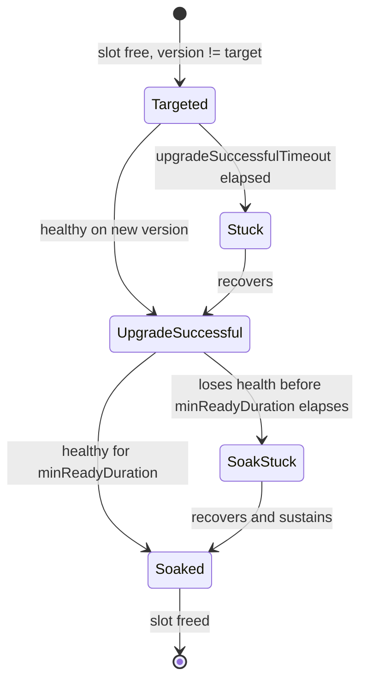
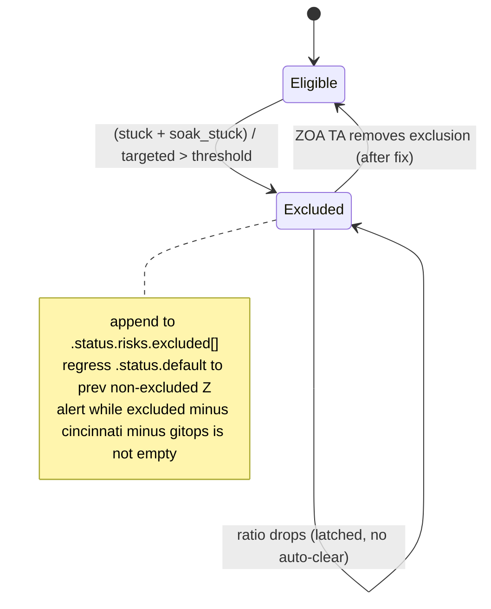

# ROSA V2 Cluster Upgrades

## Resources

- [OCP Upgrade Graph](https://access.redhat.com/labs/ocpupgradegraph/update_path)
- [OCP Release Status](https://amd64.ocp.releases.ci.openshift.org/)

## Terminology

- **Channel:** The rollout stream that declares the minor version and stability tier (e.g., stable-4.22, fast-4.23).
- **Default Z (x.y.default-z):** The target z-stream for a given channel, i.e. the Channel CR's `.status.default`.
- **Platform-specific risk exclusions:** Excluding versions marked with platform-specific risks in the Cincinnati graph (e.g., "don't upgrade ROSA V2 to 4.22.17"). Platform-specific risk support to be delivered by OCP Q1 2027; until then, the Channel controller's SLO exclusion latch (see Automatic Z-upgrades) is the automatic interim mechanism, backed by pinned versions as a manual SRE escape hatch.

## Design Principles

The platform will test upgrades from any active Z to any other Z within the same minor version. Safety comes from testing, not graph edges (no edge checking for z-stream jumps).

The goal is to stay close to current rather than waiting for long bake times, because extended delays (6-8 weeks) accumulate open CVEs. Safety comes from defense in depth via testing and progressive rollout, not from predicting all risks ahead of time.

The platform does **not** perform per-cluster CVO risk evaluation for Z-stream upgrades. CVO-reported cluster-specific risks are not factored into the automatic upgrade decision. Instead, the platform:

- Relies on CI testing to catch issues before rollout.
- Uses platform-specific risks in the graph (fleet-wide blocks).
- Provides exclusions and pinned versions as an escape hatch for known exceptions.
- Will rely on the Cincinnati graph for platform-specific risk information (attached to z-releases).

### Default Z

The Default Z for a channel is governed by two independent offsets:

- **Z-offset (stability tier):** how many Z's back from the latest available Z the channel's Default Z sits, for bake-time/stability reasons. Stable and eus channels use a Z-offset of 1 (latest minus one); other channels like fast use a Z-offset of 0 (the latest available Z). This is a per-channel setting, unrelated to region.
- **Day-offset (progressive delivery):** how many days a region waits after a Z's release date before adopting it as Default Z, so a new Z doesn't land on every region at once (see Cross-Region Promotion). This is a per-region setting, unrelated to channel stability tier.

In all cases, the chosen Z must have passed ROSA V2 CI and have no platform-specific risks declared against it in Cincinnati.

### Channels

The list of supported channels is obtained from the OCP Upgrade Graph plus an allowlist/blocklist ruleset defined through gitops.

Some channels might only be accessible under feature gates.

## Installation

The customer selects the channel (e.g., stable-4.21). The platform resolves the Default Z for that channel at installation time.

## Automatic Z-upgrades

The platform will keep the fleet continuously upgraded to the Default Z for their respective channels, ensuring that clusters are always running a version that has passed CI and has no known platform-specific risks.

### Progressive Rollout

Progressive rollout is per-region: each region drives its own clusters to the Default Z independently, with no central orchestration. The platform upgrades continuously, capped by `MAX_CONCURRENT_UPGRADES` (the number of in-flight upgrades across the region). A slot is held from the moment a cluster is targeted until it has fully soaked, so a broken Z that leaves clusters stuck naturally wedges the rollout instead of pouring more clusters into it.

A cluster must stay healthy for `minReadyDuration` after it first reports healthy on the new version before the upgrade counts as fully soaked and frees its slot.

The controller collects upgrade outcomes and uses them as its own feedback signal when the upgrade SLO is breached in a region:

- **Regional:** the response is automatic and local. The Channel controller excludes the broken Z (appends it to the channel's excluded set, latched until an SRE clears it), so the region's Default Z regresses to the previous Z and no further clusters move to the broken one. An alert is raised for SRE, who can then trigger an all-regions block manually via a ZOA TA (Trusted Action) (see Platform-Owned Risks).
- **Fleet-wide:** the same SLO breach in a single region raises an alert that writes platform risk into the Cincinnati graph data, which blocks that Z across all regions at once. Automating this alert to graph-data fan-out is the target end state.

### Cross-Region Promotion

Releases are staggered across regions through the Default Z determination itself, not through a central coordinator. Each region carries a day-offset and only treats a given Z as its Default Z once that Z has been released (out in the channel) for at least that many days (regions can be grouped so a first group leads and later groups follow). Because every region resolves its own Default Z independently, the fleet upgrades in a staggered fashion with no coordinator and no change to the per-region controller logic.

### Fleet Variance

Clusters may differ from x.y.default-z if:

- **Upgrade in progress:** Progressive rollout is mid-flight.
- **Pinned version**: SRE has pinned a cluster or group to a specific Z (via ZOA TA). This can put a cluster ahead of x.y.default-z as well as behind it.
- **Excluded versions:** SRE has excluded a cluster or group from a specific Z range (via ZOA TA) due to known incompatibility. The exclusion can be an open-ended cap (e.g., "hold at 4.22.14, no max"). The preference is not to use Excluded versions as the main mechanism, but use Cincinnati graph data instead to block at the global level.

### Monitoring & Rollback

- **Fleet visibility:** see Monitoring & Observability Requirements.
- **Rollback:** HyperShift supports rollback to previous z-stream (not y-stream), never automated. An SRE rolls a cluster back by pinning it to an older Z, through a dedicated ZOA TA that requires additional approval (see SRE Controls).

## Y+1 Upgrade

The customer changes the channel (e.g., stable-4.21 → stable-4.22). The platform does not check Cincinnati edges for this: CI coverage is sourced from the live fleet (see Testing Requirements), so every z-release actually running in production has already been tested crossing into the target channel's Default Z before any customer requests the change. The platform rejects the change only if:

- the target Z carries a release risk the platform has not accepted;
- admin acknowledgments have not been provided (policy gate, not risk evaluation);
- the change would create an N-3 control-plane skew.

Y+1 upgrades are validated via CI testing, not per-cluster CVO evaluation, and not via a live graph-edge check. Nightly and candidate testing continuously pull the fleet's actual active z-release spread for Y (across every region, including pinned and excluded clusters) and test upgrading each of those versions to both Y's Default Z and Y+1's Default Z. By the time a Z is promoted into a stable/fast/eus channel, every currently-active Y-side version has already been proven to cross into it, so a customer-requested Y+1 change never needs a runtime coverage check, only the risk/ack/skew gates above.

The platform does not perform per-cluster CVO risk evaluation for Y+1 upgrades. Safety comes from:

- CI testing sourced from the live fleet, covering every currently-active z-release's crossing into the target channel before that target ever becomes a channel's Default Z.
- Progressive rollout.
- Monitoring and rollback capability.
- Platform-specific risks in the graph (fleet-wide blocks).

## SRE Controls

SRE can perform the following controls:

<!-- prettier-ignore -->
| Control | Scope | Mechanism |
| --- | --- | --- |
| Z-release Exclusion intervals\*  (e.g. `[4.22.14, 4.22.18)`) | Fleet wide | Cincinnati Graph Data |
| Z-release Exclusion intervals | Regional | GitOps |
| Z-release Exclusion intervals | Cluster specific | ZOA TA |
| Override the channel (forces a Y-stream change) | Cluster specific | ZOA TA |
| Pin to a specific Z at or above the cluster's current version   (SRE must remove the pin for future upgrades.) | Cluster specific | ZOA TA |
| Pin to a specific Z below the cluster's current version (rollback)   (SRE must remove the pin for future upgrades.) | Cluster specific | ZOA TA, separate from the one above and requiring additional approval |

\* Note that exclusion intervals apply to all channels: a blocked z-release is unavailable for installation and as an upgrade target across every channel.

## Testing Requirements

Testing is the primary validation mechanism for both Z-stream and Y-stream upgrades. The goal is not to run the full OCP conformance suite, but to validate "the glue that manages our service" works across versions. Nightly testing provides 24h feedback for early detection and fast revert requests to OCP.

### Coverage

Platform must maintain automated test coverage for:

- **Installation:** Every supported z-release for all supported channels.
- **Z-stream upgrade:** every z-release currently active in the fleet, across all regions (including pinned and excluded clusters), upgraded to its minor's Default Z (validates the "any Z to any Z" assumption using live fleet state, not a fixed version matrix).
- **Y-stream upgrade:** every z-release currently active in the fleet for minor Y, across all regions (including pinned and excluded clusters), upgraded to Y+1's Default Z. Sourcing this from live production, rather than a static graph walk, is what lets a Y+1 channel change skip any runtime edge check (see Y+1 Upgrade): coverage already exists for every version a customer could actually be on. Every distinct version an SRE pins or excludes a cluster to is still live in production, so it adds a standing entry to this matrix for as long as the pin or exclusion exists (see Per-cluster pin/exclude in Block 2). Pinning is not free from a CI-cost perspective.
- **Feature validation:** Core platform features (ingress, node creation, KMS, HSM, storage, etc.).

### CI Testing configurations

1. **Nightly testing (\~24h feedback):** Platform runs automated tests against OCP nightly builds. Breakage triggers immediate revert request to OCP (must be within 24h; OCP will revert without argument if caught early).
   1. ROSA V2 e2e tests
   2. Upgrade tests: every z-release currently active in the fleet (across all regions, including pinned/excluded clusters) to the nightly build.
2. **Candidate testing:** Pre-release versions vetted before entering fast/stable channels.
   1. ROSA V2 e2e tests
   2. Upgrade tests: every z-release currently active in the fleet for the same minor (across all regions, including pinned/excluded clusters) to the candidate release.
   3. Y+1 upgrade tests: every z-release currently active in the fleet for the prior minor Y (across all regions, including pinned/excluded clusters) to the candidate release, when the candidate is a Y+1 target. This is what proves Y+1 coverage before the release is ever promoted, so no cluster is ever asked to cross an untested edge.

TODO: why do we need to test on a candidate if it has been tested on nightly?

CI testing will not run on fast, stable or eus channels, as the release will have been vetted through nightly and candidate testing by that point. However, the platform will monitor the installs and upgrades on new releases, and in the case of failures or regressions, it will trigger alerts that will result in adding exclusion intervals for the affected z-releases.

All ROSA V2 pre-merge CI runs on candidate.

### Upgrade tests:

- 1\. Install current z, and wait for ready
- 2\. Deploy custom workload
- 3\. Upgrade to new z
- 4\. Run ROSA V2 e2e tests and verify custom workload.

## Platform-Owned Risks

Requirement: As a platform provider, we must be able to add platform-owned risk rules for z-releases to the Cincinnati graph.

- **Scope:** Platform-wide (not per-cluster). Example: "Don't install or upgrade ROSA V2 clusters to 4.22.17 on AWS due to issue X."
- **Fallback:** Until platform-specific graph support is available, the SLO exclusion latch handles automatic detection and blocking; process-driven risk reporting plus pinned versions remain a manual SRE escape hatch.

**Note:** this changes the usual edge-exclusion semantics: instead of blocking individual upgrade edges, the exclusion blocks the z-release as a whole (all edges to it, plus new installs on it), for the given platform.

## Monitoring & Observability Requirements

- **Fleet Z-stream distribution:** Track percentage of fleet on default-z, lag distribution by version, reasons for lag (pinned, upgrade in progress, stuck, soak-stuck).
- **Stranded cluster detection:** Alert on clusters with Z \> default-z (waiting for newer default-z to be released) or Z \< default-z for longer than maximum expected rollout duration.
- **Upgrade success metrics:** Track upgrade success rate, time-to-rollout, SLO breach correlation with upgrades.
- **Pinned/excluded z-releases:** Expose which specific z-releases are currently pinned or excluded fleet-wide, labeled by version (not just a count). CI consumes this feed directly to decide what it does and doesn't need to keep testing for a given version. The platform doesn't need its own lever or policy for "stop testing a stale pin"; that decision lives entirely on the CI side, informed by this metric.

## Implementation plan

### Block 1 - API and Channel CRD

Channel CRs are Postgres-backed custom resources (not Kubernetes-native), stored under `channels`. A channel is named for its OCP minor and group, e.g. `stable-4.20`. Channel CRs are per-region: each region's Channel controller owns its own copy of a given channel, so the same channel name can resolve to a different `.status.default` in different regions once the day-offset is applied (see Block 3).

- `.spec.gates[]`: the feature gates that unlock the channel for customer selection. Empty or unset means the channel is available to all customers.
- `.status.default`: the Default Z (version and release image) the channel currently installs and upgrades to, e.g. `4.20.13`; the Channel controller resolves the image from Cincinnati and sets it.
- `.status.risks.excluded[]`: Z-versions excluded by the Channel controller's SLO latch; Default Z computation skips them. Once set, they can only be removed via ZOA TAs.

Cluster creation API and validation:

- Expose a channel field in `ClusterSpec`.
- Synchronous validation when a user sets the channel: the channel must exist and its feature gates must be satisfied.
- New API endpoint to list the available channels.
- Surface the current z-version in each Cluster's `.status`.

Install: at install time the platform resolves the channel's `.status.default` and deploys its release image.

#### Internal use case

- Feature gate marker for a `spec.release.image` override: an unvalidated pass-through to OCP, gated to entitled non-prod users, never reachable by external customers.
- Feature gate to access `private` channels (enforced by the validation above).
- Feature gate for the ability to disable upgrades: if set, the upgrade controller does not upgrade the cluster.
- Feature gate to set `pin-version` at cluster creation, so a cluster can install directly at a chosen Z instead of the channel's Default Z (see Per-cluster pin/exclude in Block 2).

### Block 2 - Upgrade controller

Scope: drive every cluster to its channel's `.status.default` (automatic Z-upgrades), and execute user-driven Y-upgrades (channel change). The target release (version and image) is already computed in `.status.default` by the Channel controller.

Reconcile loop (every ~10 min):

- A cluster's target is its `pin-version` label when present (see Per-cluster pin/exclude), otherwise `.status.default` capped by any `exclude-intervals` label. Pin is the only path allowed to move a cluster backward; targeting via `.status.default` is never a downgrade.
- A cluster is eligible for a new target when it is not currently in-flight and its version differs from this target. An in-flight cluster is skipped here even if its target has since changed: it is never retargeted mid-upgrade, only re-evaluated for a new target once its current one finishes (see Per-cluster lifecycle).
- Staggering: `MAX_CONCURRENT_UPGRADES` caps in-flight upgrades, pin-driven or automatic alike. A cluster counts as in-flight from the moment its `TargetedForUpgrade` condition is set until its `UpgradeSuccessfulSoak` condition matches that same recorded release, so the count survives controller restarts. Pick up a new cluster only while in-flight is under the cap. When more clusters are eligible than free slots, pick up the ones furthest behind their target first, so a cluster that's fallen several Z's behind doesn't keep losing slot contention to ones that just became eligible.

Per-cluster lifecycle (the slot is held against the recorded target release from target until full soak, even if `.status.default` advances to a newer Z while the upgrade is in flight: a cluster always finishes the upgrade it was targeted for before it can be retargeted):

- Target: set the `TargetedForUpgrade` condition (release and timestamp), set `.spec.release.image` from the cluster's target. `seaplane_cluster_upgrade_targeted{channel,version}` is emitted from the presence of this condition and is never removed.
- `UpgradeSuccessful` status condition: the cluster reports healthy on the new version.
- `UpgradeSuccessfulSoak` status condition: the cluster has stayed healthy for `minReadyDuration` (clock starts at `UpgradeSuccessful`). At this point the cluster is fully upgraded and frees its slot.

`stuck` and `soak_stuck` are not independent state the controller sets and must remember to unset. Each reconcile, the controller already knows (from the `TargetedForUpgrade`/`UpgradeSuccessful` timestamps) whether a cluster has blown through its timeout, so it recomputes the comparison and emits or withholds the metric fresh every loop. The metric's appearance fires the alert immediately (the timeout is already applied in the controller's comparison, so no `for:` duration is needed in the alerting rule); once the cluster succeeds or soaks, the controller simply stops emitting it next loop and the alert resolves:

- `seaplane_cluster_upgrade_stuck{channel,version,uuid}`: emitted while a cluster is targeted at a release and has not reported `UpgradeSuccessful` for it within `upgradeSuccessfulTimeout` of the `TargetedForUpgrade` timestamp; withdrawn once it succeeds. Pages SRE.
- `seaplane_cluster_upgrade_soak_stuck{channel,version,uuid}`: emitted while a cluster has reported `UpgradeSuccessful` for a release but lost health again before reaching `minReadyDuration` since that timestamp, without yet reaching `UpgradeSuccessfulSoak`; withdrawn once it soaks. Pages SRE.

Metric cardinality: `targeted` is labeled `{channel,version}` only, because every cluster is targeted and per-cluster series would be too many. `stuck` and `soak_stuck` carry `uuid` because we expect few and need to name the offending clusters.

`stuck` and `soak_stuck` only cover a cluster that's already been targeted and is failing to land, not a cluster sitting untargeted (ahead of `.status.default` after an SLO-latch regression or a deliberate pin, or behind it because `MAX_CONCURRENT_UPGRADES` hasn't picked it up yet). `seaplane_cluster_version{channel,version}` counts clusters per channel and version, recomputed each reconcile: this is the region's own equivalent of Telemeter's `cluster_version`, giving Fleet Z-release distribution a regional-native source that doesn't depend on an external pipeline. Stranded cluster detection is a query over it: any non-default version whose count stays non-zero past the expected rollout window, ahead or behind.

Remediation (no automatic rollback):

- Stuck and soak-stuck clusters hold their slots and roll forward: SRE fixes them in place until they soak, or they skip the bad Z once the Channel controller promotes the next Z into `.status.default` (the excluded Z is no longer a target, and the next loop retargets them).
- HyperShift supports rollback, but the controller never downgrades automatically. An SRE performs a rollback by pinning the cluster to an older `<z>` (see Per-cluster pin/exclude), through the dedicated rollback ZOA TA.

Per-cluster pin/exclude: SRE pins or excludes a cluster via a label on the Cluster, set through a ZOA TA:

- `seaplane.io/pin-version: <z>`: replaces `.status.default` as the cluster's target, regardless of what `.status.default` is. The reconcile loop drives the cluster to `<z>` through the normal Target → UpgradeSuccessful → UpgradeSuccessfulSoak lifecycle, the same conditions and metrics as any other upgrade. Two separate ZOA TAs set this label, not one: pinning to `<z>` at or above the cluster's current version is the ordinary action; pinning to a `<z>` below it is a rollback and goes through a separate ZOA TA requiring additional SRE approval (see SRE Controls).
- `seaplane.io/exclude-intervals: <z1,z2)[,<z3,z4)...]`: caps what `.status.default` can target, same interval semantics as the fleet-wide exclusion intervals (see SRE Controls); a range can be open-ended (e.g. `[4.22.14,)`) to cap the cluster with no upper bound. The reconcile loop skips any target that falls in an excluded interval.
- SRE removes the label to resume automatic upgrades. A label (rather than a spec field) keeps this a simple, selector-friendly mechanism: SRE tooling and the "clusters pinned z releases" metric can both list affected clusters with a label selector instead of scanning cluster status.
- Cost: pinning is not free. A pinned or capped cluster is still live in production, so its version is part of the active z-release spread that Testing Requirements sources CI coverage from: every distinct `<z>` a cluster is pinned or capped at becomes a standing entry in the nightly/candidate test matrix for as long as the label exists. Pinning several clusters at different versions multiplies that matrix; SRE should keep pins rare, temporary, and consolidated (prefer capping multiple clusters at the same `<z>` over scattering them across different ones).
- `seaplane_cluster_pinned{version}`: emitted per distinct version currently named by a `pin-version` or `exclude-intervals` label somewhere in the fleet. Labeled by version, not cluster, since the point is to tell external CI what versions are still pinned in production, not to enumerate clusters; CI decides for itself whether and how long to keep testing a given version.
- `seaplane_cluster_pin_active{uuid,channel}`: emitted per pinned or excluded cluster, by uuid. Always firing while the label is present, routed silently (visible, no page) by default; promoted to paging once the cluster's channel has an EOL date scheduled (see Block 6), since a pinned cluster can't climb to a dying minor's Default Z or follow the forced flip on its own.

User-driven Y-upgrade (channel change). The same-minor hop is always allowed. A minor change `x.y.z -> x.y+1.z'` is not graph-checked: Testing Requirements already guarantees every currently-active Y-side z-release has CI-proven coverage crossing into Y+1's `.status.default` before that `.status.default` is ever set, so there is nothing left to validate against Cincinnati at request time. Reject the change if:

- the target Z carries a release risk the platform has not accepted;
- required admin acknowledgments have not been provided;
- the change would create an N-3 control-plane skew.

`.spec.channel` is the same mutable field either way: the customer sets it directly through the API (subject to the checks above), or SRE sets it on their behalf through the "override the channel" ZOA TA (see SRE Controls).

Status:

- Surface the channels (and target Z) the cluster can move to.

Configuration:

- `MAX_CONCURRENT_UPGRADES`: maximum clusters upgrading at once.
- `minReadyDuration`: how long a cluster must stay healthy on the new version to count as soaked.
- `upgradeSuccessfulTimeout`: grace period before a cluster that has not reported healthy on the new version is counted stuck.

Conditions (on the Cluster). Each condition records the release it refers to, so the controller evaluates progress by matching the condition's release against the cluster's current target (no destructive reset on retarget; the per-version metrics follow the same release label):

- `TargetedForUpgrade`: the release the cluster was targeted at, and when; always present once an upgrade has started.
- `UpgradeSuccessful`: the release the cluster last reported healthy on.
- `UpgradeSuccessfulSoak`: the release the cluster has sustained health on for `minReadyDuration`.

Monitoring:

- Alert if a cluster's target (`pin-version` or `.status.default`) cannot be resolved to a valid release image for a period of time. This is a distinct failure mode from `stuck`/`soak_stuck`: it happens before `TargetedForUpgrade` is ever set, so neither of those metrics would catch it.

Testing:

- Integration tests run against the local Postgres and DynamoDB container interfaces (no LocalStack).
- Stub the Cincinnati and sippy clients. Drive the controller by editing Channel objects and cluster state, inject stuck and soak-stuck failures, and assert on the conditions, the emitted metrics, and what the controller writes to DynamoDB.

### Block 3 - Channel controller

Scope: own the Channel CRs and compute each channel's `.status.default`.

Channel discovery:

- GitOps provides a list of rulesets that define what channels are supported (plain names or regexes), matched against channel names in the OCP Upgrade Graph (Cincinnati). Allow-list only those channels.
- For each supported channel, create and maintain a Channel CR, assigning `.spec.gates[]` by the GitOps rules.

Default Z computation:

- Query Cincinnati (and sippy for nightlies) for new-Z discovery and Z release risks (future state); set `.status.default` to the Default Z (version and image) in the channel. No edge data is needed here or anywhere in Block 2: Y+1 crossings are validated by CI coverage sourced from the live fleet, not by querying Cincinnati's graph (see Y+1 Upgrade).
- The same-minor decision is deliberately simple: take the latest Z in the channel, back off by the channel's Z-offset (a stability-tier setting, e.g. stable/eus = 1, fast = 0), then walk further back past any Z that fails either filter:
  - skip any Z in the effective exclusion set (the union of Cincinnati Z release risks, GitOps exclusions, and the channel's own `.status.risks.excluded[]`);
  - skip any Z that has not yet been out for the region's day-offset (a per-region delay delivered by GitOps, measured from the Z's release date). Staggering this offset across regions produces cross-region progressive rollout: a Z becomes the default in leading regions first and in trailing regions only once it has aged enough.

SLO exclusion latch:

- Watch `seaplane_cluster_upgrade_targeted`, `seaplane_cluster_upgrade_stuck`, and `seaplane_cluster_upgrade_soak_stuck`. When `(stuck + soak_stuck) / targeted > threshold` for a (channel, version), append that version to `.status.risks.excluded[]` and regress `.status.default` to the previous non-excluded Z. There is no minimum-sample floor for now: a single early failure can trip the threshold and block the channel (a floor is a future refinement).
- `seaplane_channel_excluded_version{channel,version,source}`: one series per currently-excluded version, with `source` set to `slo_latch`, `cincinnati`, or `gitops`. Fire an alert while a `slo_latch` series has no matching `cincinnati` or `gitops` series for the same version. SRE resolves it one of two ways, both of which clear the alert:
  - the Z is genuinely bad: formalize the exclusion in Cincinnati (future state) or GitOps (stopgap);
  - it was a false positive (for example one unhealthy MC): fix the underlying cause so the gauges fall, then remove the exclusion with a ZOA TA.
- The exclusion is latched. The controller never removes it automatically, even after the ratio falls back under threshold. Removal is always an explicit ZOA TA, and it must follow the fix (otherwise the next loop re-adds the exclusion). Once excluded, a Z is never reconsidered for upgrades until the exclusion is removed.

Configuration: `threshold` (the SLO ratio that trips the latch), the per-channel Z-offset (stability tier), and the per-region day-offset (progressive delivery), all GitOps-delivered.

Future state: Cincinnati exclusions only; the GitOps exclusion path is a stopgap until Cincinnati risk submission exists and should be removed then.

### Block 4 - Metrics

<!-- prettier-ignore -->
| Metric | Requirement | Exposed by | Calculation |
| --- | --- | --- | --- |
| Telemeter `cluster_version` | Fleet Z-release distribution | CVO, via HyperShift's control-plane ServiceMonitor | CVO-reported actual/desired/updating/completed version per cluster |
| `seaplane_cluster_upgrade_targeted{channel,version}` | Upgrade success metrics | Upgrade controller (Block 2) | Presence of the `TargetedForUpgrade` condition; set once, never withdrawn |
| `seaplane_cluster_upgrade_stuck{channel,version,uuid}` | Upgrade success metrics, Stranded cluster detection | Upgrade controller (Block 2) | Recomputed each reconcile: true while targeted at a release and `UpgradeSuccessful` hasn't landed within `upgradeSuccessfulTimeout` of the `TargetedForUpgrade` timestamp; withdrawn on success |
| `seaplane_cluster_upgrade_soak_stuck{channel,version,uuid}` | Upgrade success metrics, Stranded cluster detection | Upgrade controller (Block 2) | Recomputed each reconcile: true while `UpgradeSuccessful` has landed but health is lost again before `minReadyDuration` since that timestamp, with `UpgradeSuccessfulSoak` not yet reached; withdrawn on soak |
| `seaplane_cluster_version{channel,version}` | Fleet Z-release distribution, Stranded cluster detection | Upgrade controller (Block 2) | Count of clusters per channel and version, recomputed each reconcile; the regional-native equivalent of Telemeter's `cluster_version` |
| `seaplane_cluster_pinned{version}` | Pinned/excluded z-releases | Upgrade controller (Block 2) | One series per distinct version currently named by a `pin-version` or `exclude-intervals` label anywhere in the fleet |
| `seaplane_channel_excluded_version{channel,version,source}` | SLO exclusion latch alerting | Channel controller (Block 3) | One series per currently-excluded version, `source` set to `slo_latch`, `cincinnati`, or `gitops`; alerts when a `slo_latch` series has no matching `cincinnati` or `gitops` series |
| `seaplane_cluster_pin_active{uuid,channel}` | EOL pin escalation | Upgrade controller (Block 2) | One series per pinned or excluded cluster; always firing, routed silently by default |
| `seaplane_channel_eol_scheduled{channel}` | EOL pin escalation | EOL controller (Block 6) | Set to 1 once `installsClosedDate` or `eolDate` is set on the channel; joined against `seaplane_cluster_pin_active` to promote that alert to paging |

### Block 5 - CI

Scope: implement the Testing Requirements coverage (install, Z-stream upgrade, Y-stream upgrade sourced from the live fleet) as an extension of the `rosa-hyperfleet-ephemeral-e2e` workflow (openshift/release), reusing `rosa-hyperfleet-resolve-ocp-image` for nightly/candidate payload resolution.

- Fleet discovery: a step, sibling to `resolve-ocp-image`, queries the Platform API for every z-release currently active for a given minor, across all regions, including pinned/excluded clusters.
- Controls: `pin-version`, settable at creation (Block 1) and updatable afterward (Block 2), drives every version transition in these tests. It installs the cluster directly at the chosen Z, and changing it later triggers an upgrade through the same Target → UpgradeSuccessful → UpgradeSuccessfulSoak lifecycle and metrics production uses.
- Upgrade step: after install, change `pin-version` to the second target release, wait for `UpgradeSuccessfulSoak`, then re-run the e2e suite against the upgraded cluster.
- One periodic per cadence (nightly, candidate), looping over the discovered active-Z list and reusing the provision/teardown steps per version; each version reports its own pass/fail so one bad pairing doesn't mask the rest.
- Candidate also tests the prior minor's active Z's crossing into the candidate release when it's a Y+1 target.

Depends on Blocks 1-3: the fleet discovery and upgrade steps both need the Channel CRD, Upgrade controller, and Channel controller live.

### Block 6 - EOL

This is not in scope for EP1.

Depends on notifications.

EOL is a platform-driven channel change on a schedule. The climb within a minor and the minor hop after the flip are both ordinary Block 2 behavior (drive to `.status.default`), so the only new pieces are two dates, the forced flip, and the customer comms.

Channel CRD dates (GitOps/Cincinnati-delivered):

- `installsClosedDate`: after this, Block 1 validation rejects new installs and customer selection of the channel. The CR still exists and still computes `.status.default`, so existing clusters keep climbing. This replaces the dropped `enabled` flag: "closed" is a date, not a boolean.
- `eolDate`: the minor's hard end-of-life. Every cluster must be off the minor before it; the EOL controller works backward from this with a notification lead time.

New EOL controller, per cluster on an EOL-approaching channel:

- Notify: message the customer the planned forced-upgrade dates ahead of `eolDate`. This is the dependency that blocks EOL.
- Climb (reuse Block 2): no special handling; `.status.default` already pulls the cluster to the dying minor's Default Z, which is Y+1-crossable by construction once reached (see Y+1 Upgrade). There's no separate "jump-off" qualification to wait for.
- Flip: once on the dying minor's Default Z, write the channel server-side to `X.Y+1-<channelgroup>` (for EUS: `X.Y+2-eus`). The flip bypasses the Block 2 admin-acknowledgment gate (this is a forced move, not customer-initiated) and respects the N-3 skew guard before moving the control plane across a minor.
- Hand back to Block 2: the new channel's `.status.default` drives the minor hop, the same way as any other Y+1 crossing (CI-covered, not edge-checked). EUS is a one-minor-at-a-time control-plane walk `X.Y -> X.Y+1 -> X.Y+2` (EUS only lets worker nodes skip the odd-minor reboot), so Block 2 repeats climb-then-flip once per intermediate minor; the control plane itself can't skip one.

Latch collision: if the SLO latch excludes every remaining Z in the dying minor's channel, `.status.default` has no eligible target left and the cluster can no longer climb forward, stalling the migration before it ever reaches a flip-ready Z. This is correct safety (never force a cluster onto a known-bad Z, even under deadline pressure), but as `eolDate` nears the EOL controller must escalate to SRE with the conflict spelled out: fix the Z, clear the exclusion, or accept the risk via ZOA TA.

Pinned collision: a pinned or excluded cluster (see Per-cluster pin/exclude in Block 2) has the same effect as a latch collision: it can't climb to the dying minor's Default Z or follow the forced flip on its own, and nothing drives it off the minor before `eolDate`. `seaplane_channel_eol_scheduled{channel}`, emitted by the EOL controller once `installsClosedDate` or `eolDate` is set on a channel, is what turns `seaplane_cluster_pin_active{uuid,channel}` (Block 2) from a silent, always-on signal into a paging one: the pin itself isn't urgent on an ordinary channel, but the moment its channel is EOL-scheduled, SRE needs to walk that cluster forward manually well before the deadline, not discover it at `eolDate`.
